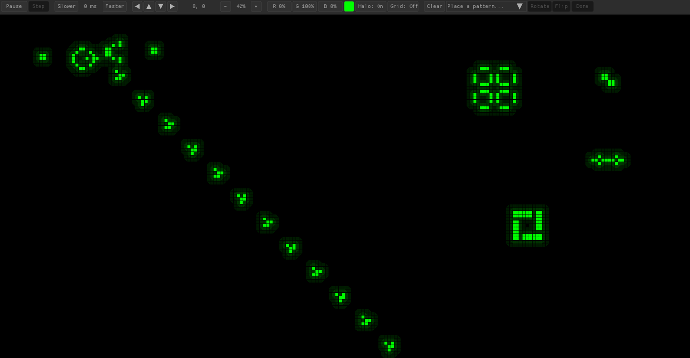
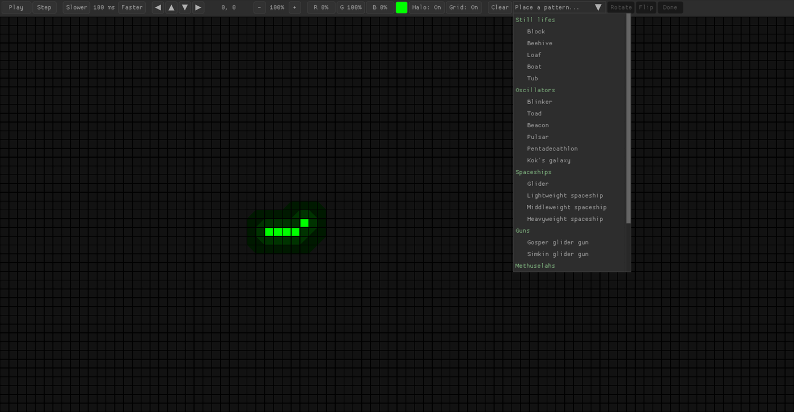
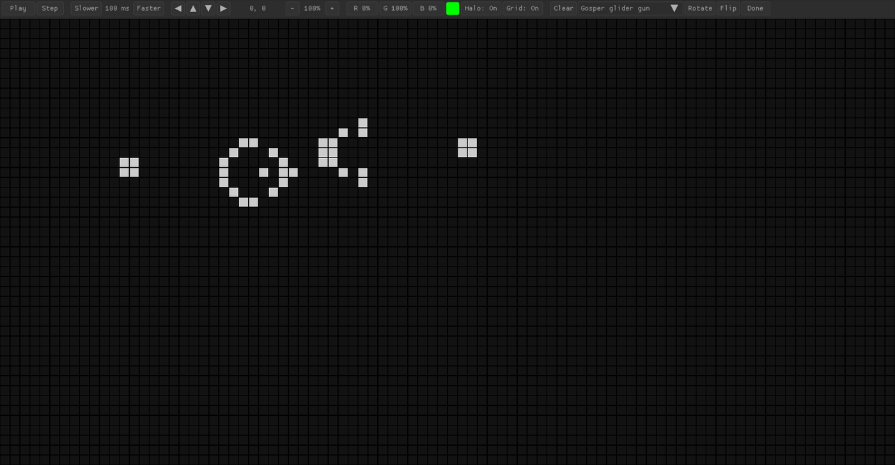
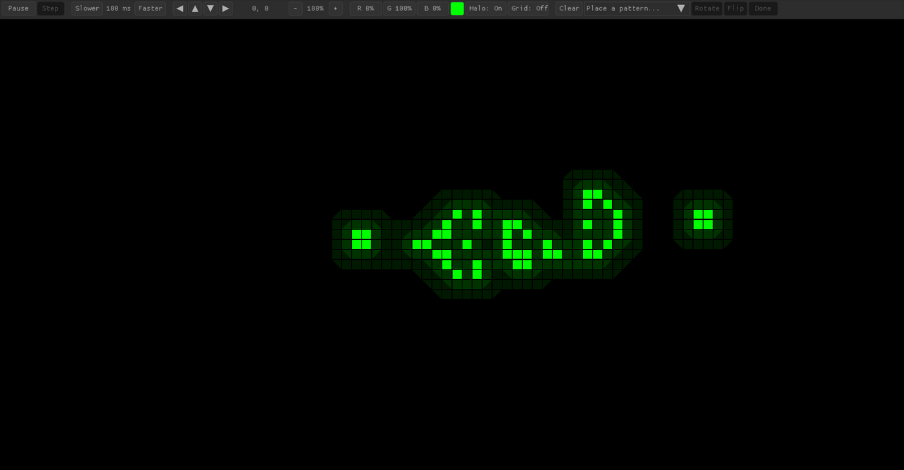

# Game Of Life In C using OpenGL

This project uses basic C libraries and OpenGL to simulate Conway's game of life on a 18,446,744,073,709,551,615 * 18,446,744,073,709,551,615 grid.

It started out in 2021 as my project for a university class on C programming. Since then it has gained a CMake build for Linux and Windows, a toolbar, zooming, cell editing and a pattern library.



## Download

Ready-to-run builds are on the [releases page](https://github.com/FeaXR/GameOfLife/releases/latest):

- **Linux**: download `Game_of_Life-x86_64.AppImage`, make it executable (`chmod +x Game_of_Life-x86_64.AppImage`, or tick "Allow executing" in its properties) and run it.
- **Windows**: download `gol-windows-x86_64.zip`, extract it and run `gol.exe` from the `gol` folder.

## Features

- An effectively unlimited grid (64-bit coordinates) with a camera you can drag around and zoom
- Click cells to flip them on or off, drag to draw
- A library of predefined structures to place with the mouse: still lifes, oscillators, spaceships, glider guns, methuselahs and an infinitely growing pattern
- A glowing halo around living cells, adjustable colors and an optional grid overlay
- A toolbar for everything, with keyboard shortcuts for the common actions (hover a button to see its shortcut)
- Runs on Linux and Windows

## Controls

| Action | Toolbar | Keyboard / mouse |
| --- | --- | --- |
| Pause / resume | Pause / Play | Space, Esc |
| Advance one generation while paused | Step | Enter |
| Slow down / speed up | Slower / Faster | Numpad - / Numpad + |
| Move the camera | Arrow buttons (hold to keep moving) | Arrow keys, drag with the middle mouse button |
| Zoom out / in | - / + | - / =, mouse wheel (zooms around the cursor) |
| Change the red, green or blue value | R / G / B | R / G / B |
| Toggle the halo effect | Halo | H |
| Toggle the grid | Grid | L |
| Flip a cell / draw cells | | Left click / drag on the grid |
| Remove every cell | Clear | |
| Place a structure | Place a pattern... | Pick one, then left click on the grid (as many times as you like) |
| Rotate / mirror the structure being placed | Rotate / Flip | Q / F |
| Stop placing | Done | Right click, Esc |







## Starting patterns

When started by clicking on the executable, it starts up with the basic initialization file (res/init/cells.init).
Other initialization files can be used when starting from a command prompt, by passing them as an argument. E.g.: `gol.exe res\init\kokgalaxy.init` on Windows, or `./gol res/init/kokgalaxy.init` on Linux.

There are 3 init files provided, the basic cells.init with a few oscillators and a glider, glidergun.init with the Gosper glider gun and kokgalaxy.init with Kok's galaxy.

New init files can be added easily, by following the pattern for each cell: `{x}; {y}\\Comment`, with each cell on its own line.

## Building

The project uses CMake (3.16+) and needs GLFW and GLEW; the toolbar uses [Nuklear](https://github.com/Immediate-Mode-UI/Nuklear), which CMake always downloads. If GLFW or GLEW aren't installed, CMake downloads and builds them automatically (or force that with `-DGOL_FETCH_DEPS=ON`). The graphics driver needs to support OpenGL 4.3 (any GPU from the last decade does).

Linux (e.g. `sudo pacman -S cmake glfw glew` or `sudo apt install cmake libglfw3-dev libglew-dev`):

```bash
cmake -S . -B build
cmake --build build
./build/gol
```

Windows (Visual Studio 2019+ with the "Desktop development with C++" workload, from a Developer Command Prompt):

```bat
cmake -S . -B build
cmake --build build --config Release
build\Release\gol.exe
```

Cross-compiling for Windows from Linux (needs `mingw-w64-gcc`):

```bash
cmake -S . -B build-win -DCMAKE_TOOLCHAIN_FILE=cmake/mingw-w64-x86_64.cmake
cmake --build build-win
```

The `res` folder is copied next to the executable on build; `cmake --install build --prefix dist --component gol` produces a folder ready to distribute.
