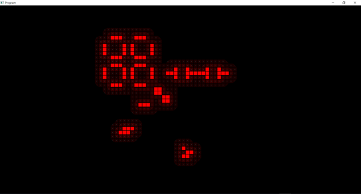
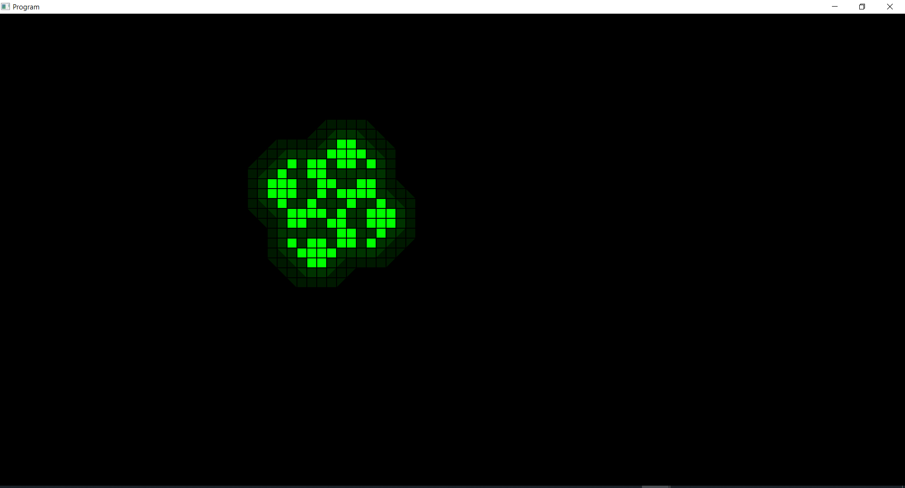
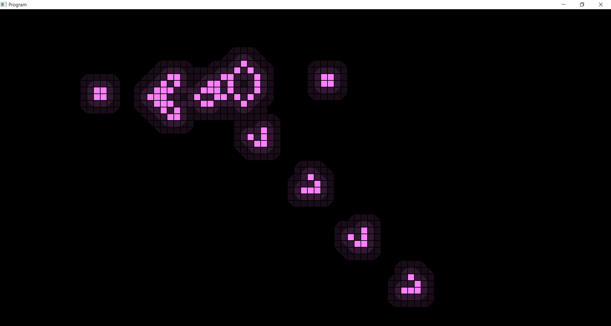
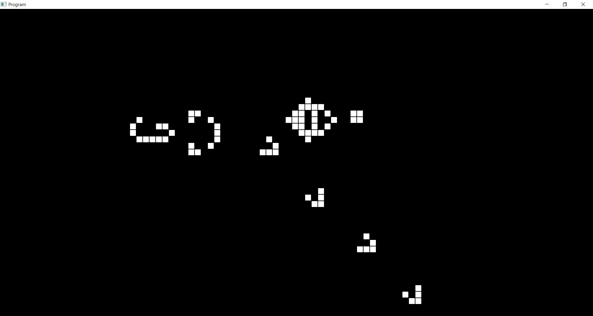

# Game Of Life In C using OpenGL


This project uses basic C libraries and OpenGL to simulate Conway's game of life on a 18,446,744,073,709,551,615 * 18,446,744,073,709,551,615 grid.

Basic controls:

- Cam movement:
- - Up, Down, Left, Right
- Game speed:
- - Numpad+: Speed up
- - Numpad-: Speed down
- - Space, escape: Stop
- - Enter: Advance game if stopped
- Visualization:
- - R, G, B - Change the Red, Green and Blue values
- - H - Toggle the Halo effect


When started by clicking on the executable, it starts up with the basic initialization file (res/init/cells.init).
Other initialization file can be used, when starting up from command prompt, using the arguments. E.g.: `gol.exe res\init\kokgalaxy.init` on Windows, or `./gol res/init/kokgalaxy.init` on Linux.

There are 3 init files provided, the basic cells.init with a few oscillators and a glider, glidergun.init with the Gosper glider gun and kokgalaxy.init with Kok's galaxy.

New init files can be added easily, by following the pattern for each cell: {x}; {y}\\\\Comment<br>
Put each individual cell in a different line!<br>
Don't leave empty lines in the file!<br>


# Building

The project uses CMake (3.16+) and needs GLFW and GLEW. If they aren't installed, CMake downloads and builds them automatically (or force that with `-DGOL_FETCH_DEPS=ON`).

Linux (e.g. `sudo pacman -S cmake glfw glew` or `sudo apt install cmake libglfw3-dev libglew-dev`):

```bash
cmake -S . -B build
cmake --build build
./build/gol
```

Windows (Visual Studio 2019+ with the "Desktop development with C++" workload, from a Developer Command Prompt):

```bat
cmake -S . -B build
cmake --build build --config Release
build\Release\gol.exe
```

Cross-compiling for Windows from Linux (needs `mingw-w64-gcc`):

```bash
cmake -S . -B build-win -DCMAKE_TOOLCHAIN_FILE=cmake/mingw-w64-x86_64.cmake
cmake --build build-win
```

The `res` folder is copied next to the executable on build; `cmake --install build --prefix dist` produces a folder ready to distribute.

# Screenshots




